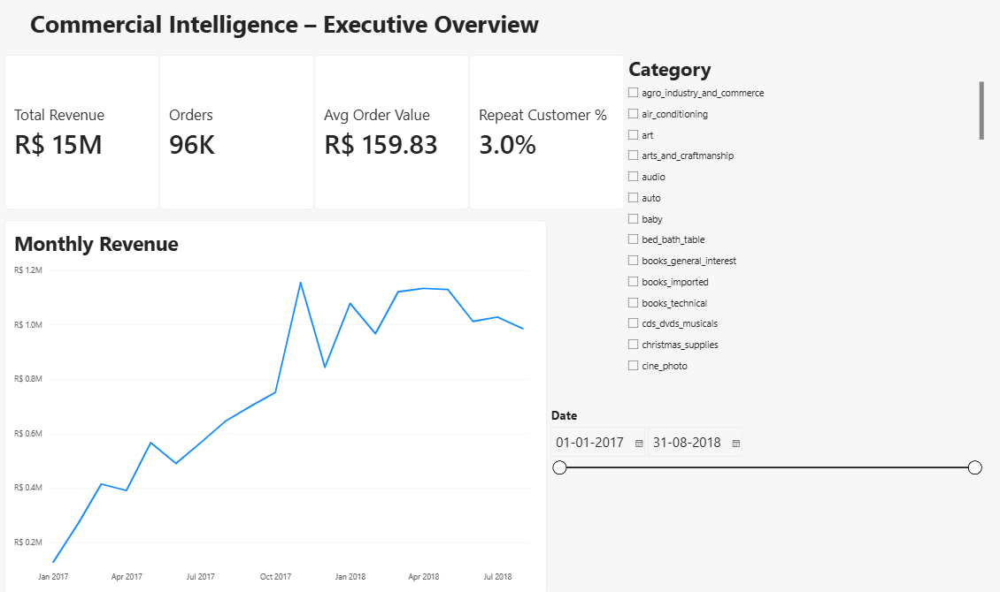
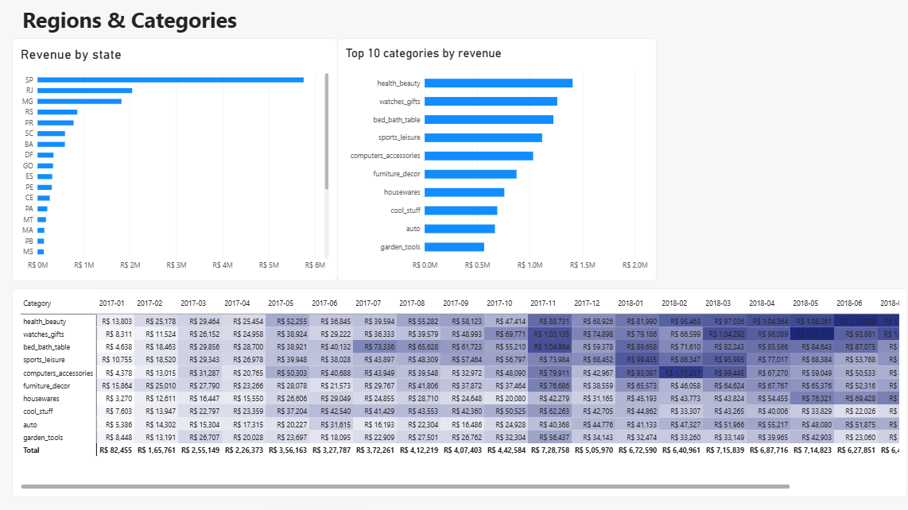
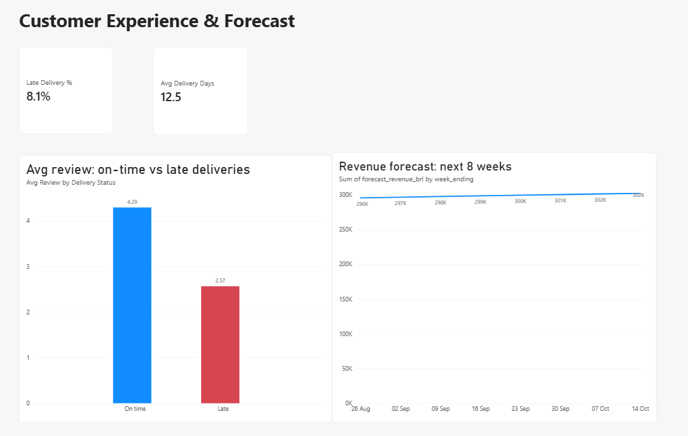

# Commercial Intelligence Platform

Sales analytics on **~110K delivered order items (96K orders, 93K customers)** from Olist, a
Brazilian e-commerce marketplace, Jan 2017 – Aug 2018. SQL for the analysis, Python for
cleaning and forecasting, Power BI for the dashboard.

**Business questions**
1. Which regions and product categories drive revenue, and which are growing fastest?
2. How does delivery performance affect customer satisfaction?
3. How well does the business keep customers?
4. What revenue should we expect in the coming weeks?

## Key findings
| # | Finding | Number | So what |
|---|---|---|---|
| 1 | Revenue is concentrated in 3 states | SP, RJ, MG = **62.6%** of revenue; SP alone 37.4% | Logistics and marketing spend should prioritise the South-East |
| 2 | No single category dominates | Top 3 categories (health & beauty, watches & gifts, bed/bath/table) = **25.3%** of revenue | Broad catalogue; growth isn't tied to one category |
| 3 | Fast growth across categories | Watches & gifts revenue grew **308%** from H1 2017 to H1 2018; health & beauty **234%** | Candidates for more seller acquisition |
| 4 | Late deliveries destroy satisfaction | **8.1%** of orders arrive late; their average review is **2.57 vs 4.30** for on-time orders, and **54%** of late orders get 1–2 star reviews (vs 9.2%) | Fixing late deliveries is the biggest lever on ratings |
| 5 | Very low repeat purchase | Only **3.0%** of customers ordered more than once | Retention programmes (loyalty, remarketing) are the main growth gap |
| 6 | Revenue is forecastable for planning | Monthly forecasts: **~94% accuracy** (WAPE 5.4–5.9%) in a 6-month rolling backtest; weekly: 83.5% (WAPE 16.5%) on a 12-week hold-out vs 61.6% naive | Monthly figures are reliable for budgeting; weekly figures are noisier (promotions, Black Friday, the May 2018 strike) |

Average order value: **R$159.83**. Average review: **4.16 / 5**.
A sharp dip in the week ending 27 May 2018 coincides with the nationwide truck drivers' strike in Brazil in late May 2018, a plausible cause (not tested).

## Power BI dashboard
3 pages, 12 visuals, 10 DAX measures (built in Power BI Desktop; guide in `powerbi/POWERBI_GUIDE.md`).

**Executive Overview** – revenue, orders, average order value, repeat-customer rate, monthly trend, category and date slicers


**Regions & Categories** – revenue by state, top 10 categories, category × month heatmap


**Customer Experience & Forecast** – late-delivery rate, delivery time, rating on-time vs late, 8-week revenue forecast


DAX notes: `Repeat Customer %` is computed from the fact table with `SUMMARIZE` so it responds to slicers;
`Avg Review` uses `TREATAS` to pass the visible orders to the review table (filters don't flow from the
fact table to a dimension on their own).

## Forecasting method
- Weekly revenue, complete weeks only (the final week of Aug 2018 is cut short by the data collection end date).
- Last 12 weeks held out; models never see them during fitting.
- Models compared: naive (last week repeats), 4-week moving average, Holt's exponential smoothing with damped trend.
- Metrics: **WAPE** (total absolute error ÷ total actual revenue) and MAPE. Accuracy = 100 − WAPE.
- Also backtested for the top 5 categories: best WAPE 15–22% per category (`outputs/forecast_by_category.csv`).
- The 8-week forward forecast uses Holt (it models trend; the moving average forecasts a flat line).

**Monthly planning forecast (rolling one-step-ahead).** At the start of each month, forecast that month
using only data available then; roll forward over the last 6 months (Mar–Aug 2018).

| Model | WAPE | Accuracy |
|---|---|---|
| Naive (next month = this month) | 5.39% | 94.6% |
| Simple exponential smoothing | 5.88% | 94.1% |
| 3-month moving average | 8.45% | 91.6% |

Honest reading: revenue plateaued in 2018 (about R$1.0–1.13M a month), so the naive rule was already
hard to beat; smoothing matched it but did not improve on it. Only 6 test months, so treat these as indicative.
Month-by-month predictions: `outputs/forecast_monthly_backtest_detail.csv`.

## Project structure
```
data/raw/            Olist CSVs (download with src/download_data.py)
sql/01_build_fact_sales.sql   joins 5 tables into one clean fact table
sql/02_analysis.sql           business queries (window functions, CTEs, Pareto, growth)
src/build_database.py         CSV -> SQLite + fact table
src/analysis.py               runs queries, saves outputs/*.csv and charts
src/forecast.py               backtest + 8-week forecast
src/export_powerbi.py         tables for Power BI
powerbi/POWERBI_GUIDE.md      step-by-step dashboard build (3 pages, 12 visuals, DAX measures)
outputs/                      results and charts
```

## Run it
```
pip install pandas matplotlib statsmodels
python src/download_data.py
python src/build_database.py
python src/analysis.py
python src/forecast.py
python src/export_powerbi.py
```

## Data
[Brazilian E-Commerce Public Dataset by Olist](https://github.com/olist/work-at-olist-data) (CC BY-NC-SA 4.0).
Revenue = item price + freight, delivered orders only, in Brazilian reais (BRL).
